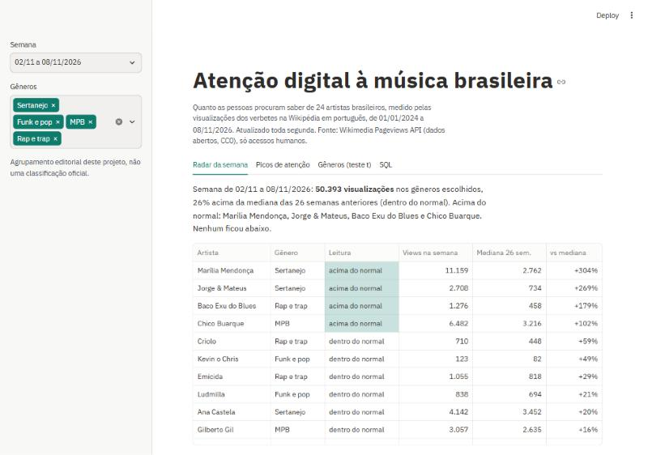
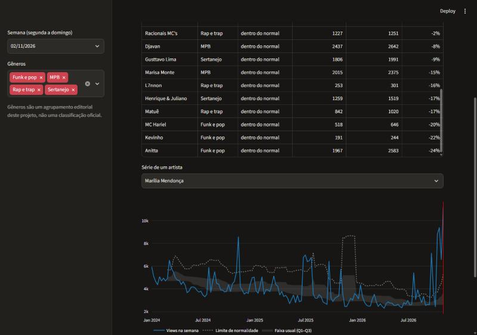
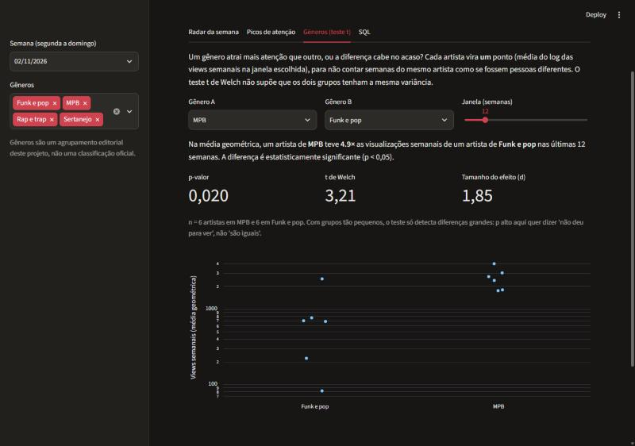

# Atenção digital à música brasileira

Painel que acompanha, semana a semana, quanto as pessoas procuram saber de 24 artistas brasileiros, medido pelas visualizações dos verbetes deles na Wikipédia em português.

**App no ar:** https://atencao-musica-brasileira.streamlit.app



## Problema

Num relatório semanal de redes sociais, uma pergunta sempre volta: "esse número é bom?". Uma alta pode ser oscilação comum ou um sinal real. Este projeto responde três perguntas com critério estatístico explícito:

1. **A semana de cada artista ficou dentro do normal?** Comparação com o histórico do próprio artista, não com uma meta arbitrária.
2. **Quais dias fugiram do padrão?** Picos de atenção que merecem investigação.
3. **Um gênero atrai mais atenção que outro, ou a diferença cabe no acaso?** Teste de hipótese com o tamanho da amostra à vista.

## Dados

- **Fonte:** [Wikimedia Pageviews API](https://doc.wikimedia.org/generated-data-platform/aqs/analytics-api/), dados abertos sob licença CC0, sem chave de acesso.
- **Recorte:** visualizações diárias de 24 verbetes da Wikipédia em português, de 01/01/2024 até o último domingo antes da coleta. Só acessos humanos (`agent=user`); robôs ficam de fora.
- **Artistas e gêneros:** 6 artistas por gênero (Sertanejo, Funk e pop, MPB, Rap e trap), listados em [`artistas.csv`](artistas.csv). O agrupamento é editorial, feito para este projeto.
- **Limite:** visualização de verbete mede interesse (gente procurando saber do artista), não audiência nem streams.

## Método

| Etapa | Arquivo | O que faz |
|---|---|---|
| Coleta | [`coleta.py`](coleta.py) | Chama a API para cada artista, respeita o limite de taxa (espera e tenta de novo) e grava no SQLite. Rodar de novo substitui as linhas, sem duplicar. |
| Banco | [`schema.sql`](schema.sql) | Duas tabelas: `artistas` e `pageviews` (chave artigo + data). |
| Consulta | [`analise.py`](analise.py) | A agregação semanal sai de SQL (semana de segunda a domingo). O app tem uma aba para rodar consultas próprias, com o banco aberto só para leitura. |
| Faixa de normalidade | `faixa_normal()` | Mediana e intervalo interquartil (IQR) das 26 semanas anteriores. Acima de Q3 + 1,5 × IQR é "acima do normal", o critério do boxplot. Com menos de 8 semanas de histórico, não julga. |
| Picos | `picos()` | z-score robusto em escala log: mediana e MAD dos 90 dias anteriores, corte em 3,5. Mediana e MAD não se deixam distorcer por um único dia viral, como aconteceria com média e desvio padrão. |
| Comparação de gêneros | `welch()` | Teste t de Welch sobre a média do log das views semanais **por artista**. Cada artista é uma observação, para não contar 12 semanas do mesmo artista como 12 casos independentes. Welch porque não supõe variâncias iguais. Mostra p-valor, tamanho do efeito (d de Cohen) e n. |
| Testes | [`tests/`](tests) | `pytest` com dados sintéticos: a faixa classifica certo, o pico plantado é achado, o teste respeita a amostra mínima, toda semana do SQL começa na segunda. |

## Resultado

Leituras da coleta de 13/11/2026 (o painel recalcula a cada coleta):

- **Picos explicáveis:** o maior pico de Chico Buarque foi em 19/06/2024, dia em que ele fez 80 anos: 10.961 visualizações contra 592 num dia típico, 18,5 vezes mais. Na semana de 02/11/2026, a de Marília Mendonça somou 11.159 visualizações, 304% acima da mediana de 26 semanas, na semana em que se completaram cinco anos da morte dela (05/11/2021). O método aponta *quando* a atenção saltou; o *porquê* sai da checagem em notícias.
- **Gêneros:** nas últimas 12 semanas, um artista de MPB teve, em média geométrica, 4,9 vezes as visualizações semanais de um artista de Funk e pop (Welch, p = 0,020, d = 1,85, n = 6 por grupo). Funk e pop contra Rap e trap não teve diferença detectável (p = 0,51). Com 6 artistas por grupo, p alto quer dizer "não deu para ver", não "são iguais".





## Como rodar

```bash
python -m venv .venv
.venv/Scripts/activate        # Linux/macOS: source .venv/bin/activate
pip install -r requirements.txt
python coleta.py              # atualiza data/atencao.db (opcional: o banco já vem no repositório)
streamlit run app.py
python -m pytest tests -q
```

## Próximos passos

- Coleta agendada (GitHub Actions) para o painel se atualizar sozinho toda segunda.
- Cruzar os picos com datas de lançamento e notícias para classificar a causa.
- Somar uma segunda fonte de atenção, como seguidores em plataformas de streaming.

---

Projeto de portfólio de Lucas Tapajós. Os artistas aparecem só como objeto de dados públicos; o projeto não tem relação com eles nem com suas gravadoras.
